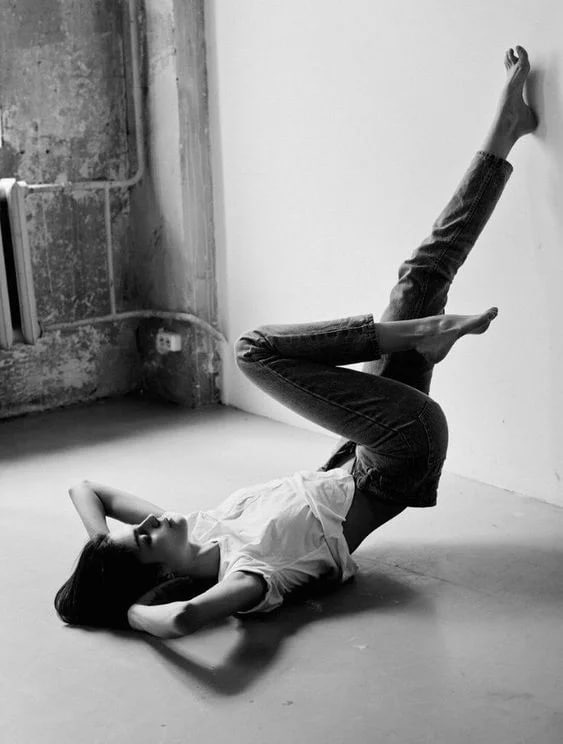
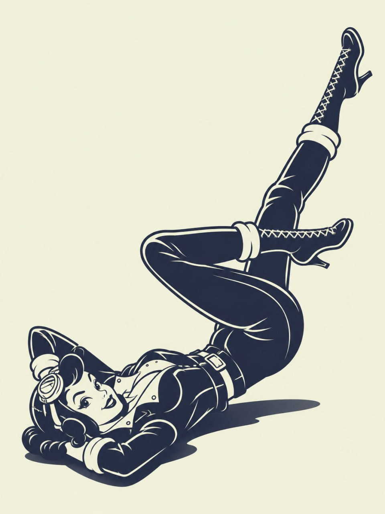
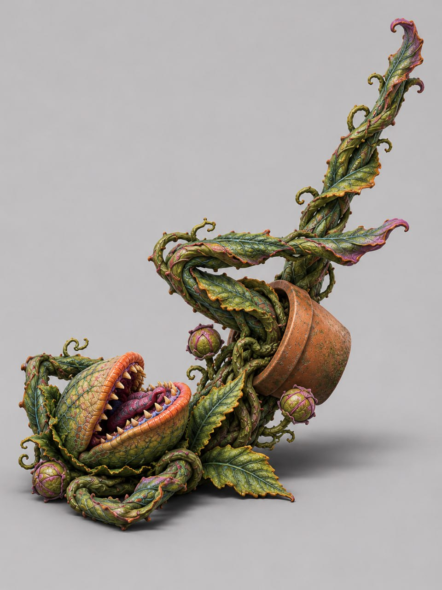
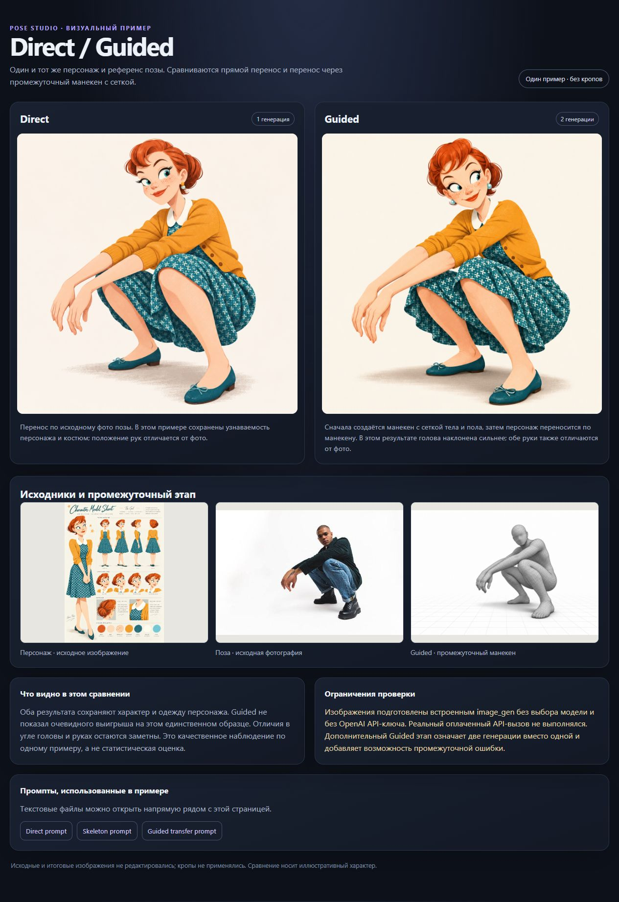

# Poser · Pose Studio для ChatGPT

**Переносите позу с фотографии на своего персонажа.** Poser — локальное приложение с русским интерфейсом: загрузите изображение персонажа, добавьте референс позы и получите новую иллюстрацию. Это адаптация поузера для Nano Banana под генерацию изображений OpenAI.

Два алгоритма: **прямой перенос** и **перенос через манекен с сеткой**. Генерация запускается через встроенный мост Codex с входом ChatGPT либо через OpenAI Images API. Также можно подготовить промпт и выполнить задачу вручную в ChatGPT.

[Инструкция по использованию](docs/USAGE.md) · [Примеры и сравнение](docs/EXAMPLES.md) · [Проверки и ограничения](docs/VERIFICATION.md)

## Одна поза — разные персонажи

Фотография слева — **исходный референс позы**. Три рисунка справа — предоставленные автором демонстрации работы пакета.

| Референс позы | Иллюстрация | Графический персонаж | Фантастическое существо |
|:---:|:---:|:---:|:---:|
|  |  |  |  |

Изображения сохранены без кадрирования. Настройки и исходные изображения персонажей для этих трёх результатов не приложены; примеры показывают возможности переноса, но не являются сравнением моделей или режимов.

## Возможности

- Прямой перенос по фотографии или двухэтапный перенос через направляющую.
- Манекен с сеткой поверхности тела и перспективной сеткой пола; всего пять типов направляющих.
- Дополнительные изображения лица, одежды и других деталей персонажа.
- Текстовые уточнения, художественная интеграция, пять соотношений сторон, 1–3 варианта.
- Доработка выбранного результата, отмена последней доработки, увеличение и скачивание.
- Запуск и остановка в Windows двойным щелчком по BAT-файлу.

## Быстрый старт в Windows

1. Установите **Node.js 22.15 или новее**, если он ещё не установлен.
2. Скачайте репозиторий через **Code → Download ZIP** и распакуйте его. Либо клонируйте:
   ```powershell
   git clone https://github.com/BenderBlender/Poser.git
   ```
3. В распакованной папке запустите **Start-Pose-Studio.bat**. При первом запуске он установит библиотеки, соберёт приложение и откроет браузер.
4. По умолчанию приложение доступно по адресу **http://127.0.0.1:3000**.
5. Выберите способ подключения, загрузите персонажа и позу, оставьте режим **«Прямой»**, нажмите **«Сгенерировать позу»**.

Для завершения работы запустите **Stop-Pose-Studio.bat**. Закрытие вкладки браузера не останавливает приложение. Повторный запуск BAT открывает уже работающий экземпляр.

### Подключение генератора

| Способ | Что требуется | Как используется |
|---|---|---|
| **Через подписку Codex** — по умолчанию | Установленный Codex, вход через ChatGPT и доступная генерация изображений в этом входе | Встроенный мост запускает генерацию; API-ключ не нужен |
| **OpenAI API** | Ключ OpenAI API и доступ к выбранной модели | Ключ задаётся в `.env.local`, генерация выполняется через Images API |
| **Подготовить для ChatGPT** | Работающее приложение; для самой генерации — ChatGPT с возможностью создавать изображения | Приложение готовит текст, а изображения и промпт вы отправляете в ChatGPT самостоятельно |

Настройка каждого способа подробно описана в [инструкции](docs/USAGE.md). Подтверждение входа Codex не показывает остаток лимита. Приложение не переключает способы подключения и не повторяет неудачные запросы автоматически.

## Прямой перенос и манекен с сеткой

| Режим | Что получает генератор | Этапы для одного результата |
|---|---|---:|
| **Прямой** | Персонаж + исходное изображение позы | 1 |
| **С направляющей** | Сначала фото позы → манекен; затем персонаж + манекен | 2 |

Для манекена с сеткой выберите **«С направляющей» → «Перспектива + Каркас»**. Это направляющая по умолчанию: сетка тела описывает объём, сетка пола — перспективу. На втором этапе исходное фото позы не добавляется.

[](docs/EXAMPLES.md)

На этом отдельном тестовом примере оба способа сохранили образ и костюм персонажа, но допустили отличия в положении рук. Явного преимущества манекена здесь нет. Изображения сравнения созданы встроенным генератором чата; они не подтверждают сквозную работу обоих подключений приложения. [Подробности проверки](docs/VERIFICATION.md).

## Файлы и сохранение

Поддерживаются **PNG, JPEG/JFIF и WebP**: до **12 МиБ на файл**, до **8 дополнительных референсов**, до **60 МиБ изображений в одном запросе**. Результат можно скачать из интерфейса. Мост также сохраняет изображения в `output/subscription/`; входы его запросов — в `.codex-inputs/`.

Интерфейс работает локально, а изображения для генерации отправляются в выбранный сервис. `.env.local`, рабочие изображения и журналы не включены в репозиторий и экспорт исходного кода. Публичные демонстрации лежат отдельно в `docs/examples/`.

## Для разработчика

```powershell
npm ci
npm run dev
```

Для готовой сборки: `npm run build`, затем `npm start`. Сервер слушает только `127.0.0.1`; публичное размещение этой версии не предусмотрено. При запуске из терминала остановка выполняется через `Ctrl+C` в том же окне.

```powershell
npm test
npm run lint
npm run build
```

Обычные тесты не запускают внешнюю генерацию. Стек: React, TypeScript, Vite, Express. Общие промпты находятся в `shared/prompts.ts`, подключение API — в `backend/openai.ts`, адаптер подписки — в `backend/subscription.ts`, встроенный мост — в `vendor/codex-image-bridge/`.

Мост перенесён из авторского проекта `Codex-Cloude_Genaration_Plugin`; внешняя папка этого проекта, расширение Chrome и Claude Desktop для запуска Poser не требуются. [Происхождение и изменения моста](vendor/codex-image-bridge/README.md).
