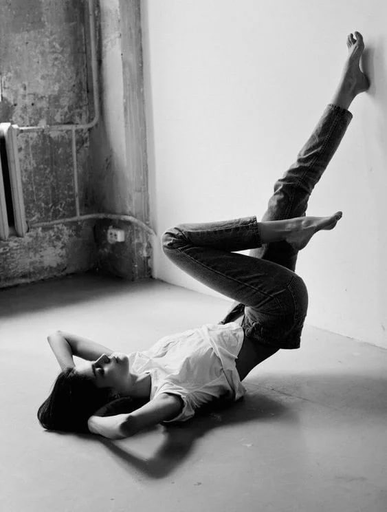
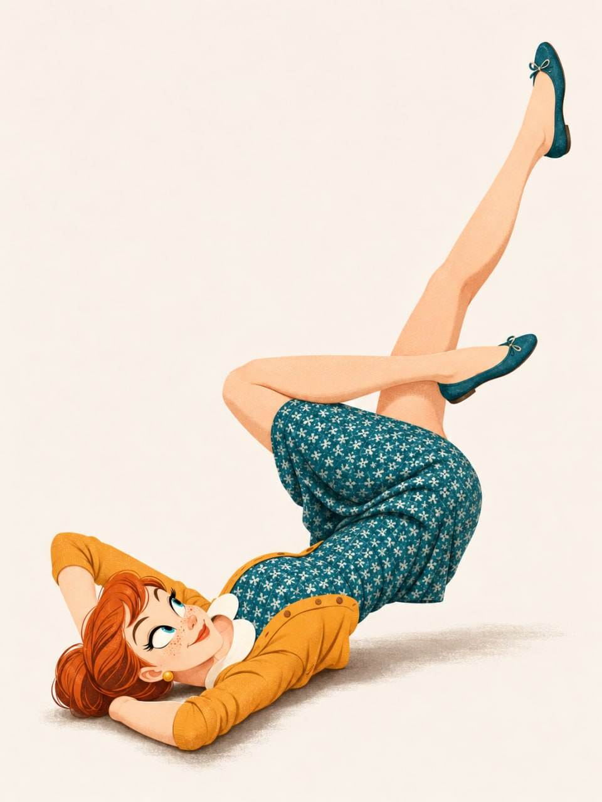
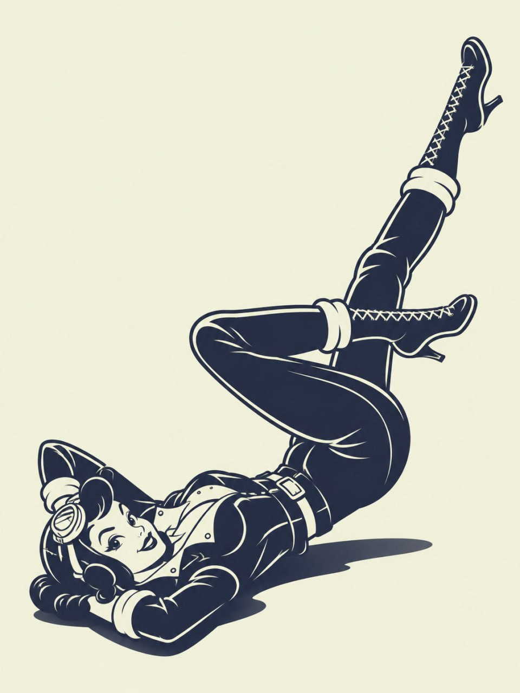
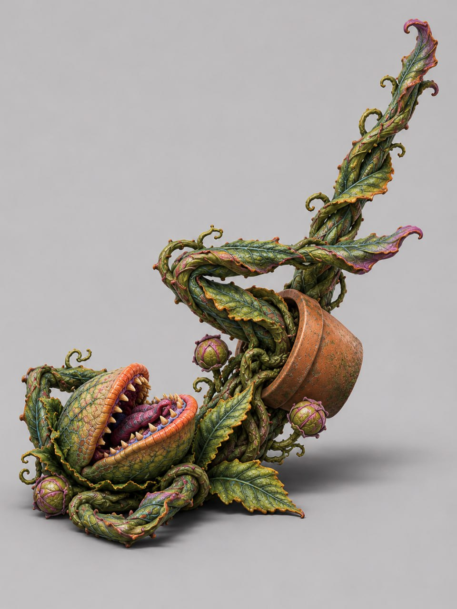
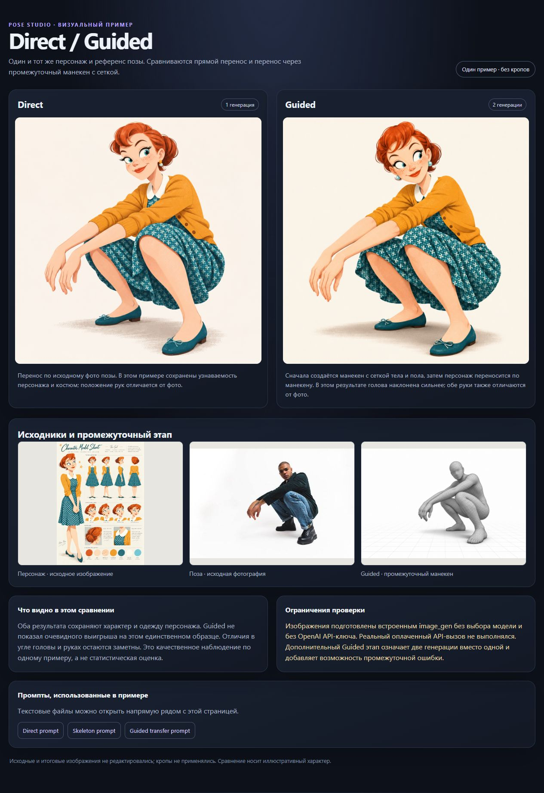
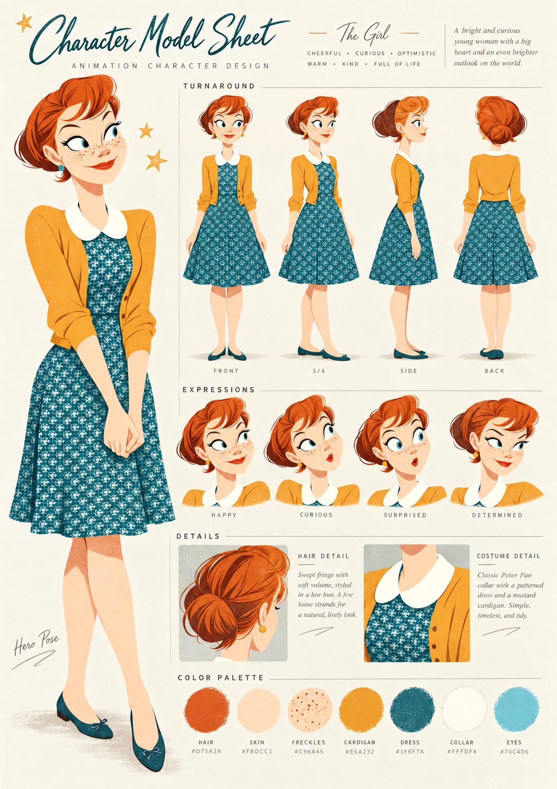
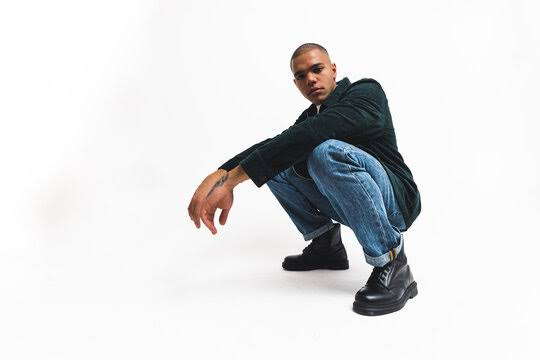
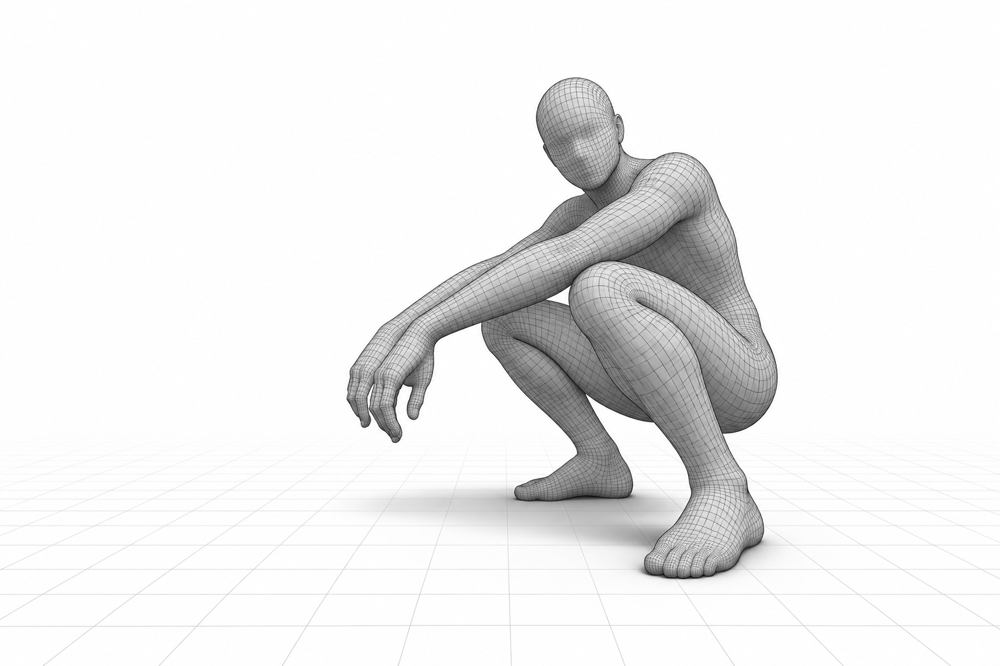
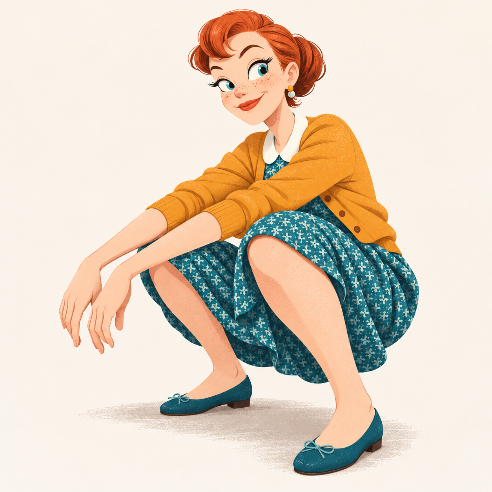
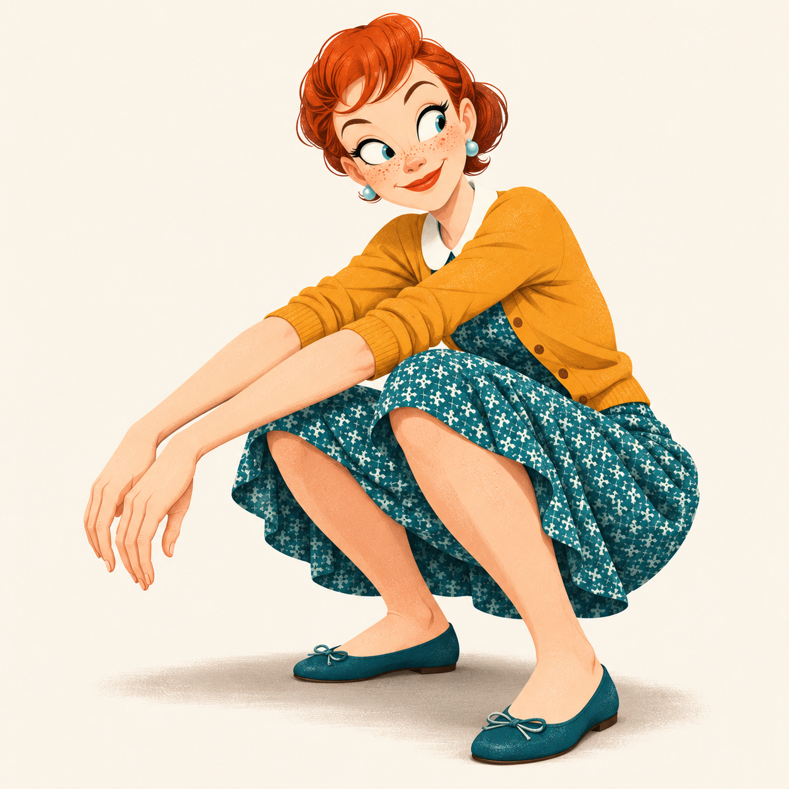

# Примеры работы

[Описание проекта](../README.md) · [Инструкция](USAGE.md) · [Проверки](VERIFICATION.md)

## Авторская демонстрация: одна поза, три образа

Фотография девушки — исходный **референс позы**. Три рисунка предоставлены автором как демонстрации работы пакета. Исходные изображения персонажей, промпты и настройки этих запусков не приложены, поэтому здесь не приписывается конкретная модель или алгоритм.

| Исходное фото позы | Иллюстрация |
|:---:|:---:|
|  |  |

| Графический персонаж | Фантастическое существо |
|:---:|:---:|
|  |  |

Примеры показывают перенос общей композиции на персонажей с разной внешностью и устройством тела. Все четыре изображения сохранены без редактирования и кадрирования.

## Прямой перенос и манекен с сеткой

Отдельный опыт от **16 ноября 2026 года**: один персонаж, одно фото позы и по одному итоговому изображению для каждого алгоритма. Исходники и результаты сохранены без редактирования и кадрирования.

### Исходники и направляющая

| Персонаж | Поза | Манекен с сеткой |
|:---:|:---:|:---:|
|  |  |  |

### Итоговые изображения

| Прямой перенос | Через манекен |
|:---:|:---:|
|  |  |

В обоих результатах узнаваемы персонаж и одежда. Положение рук отличается от исходного фото; в варианте через манекен голова наклонена сильнее. На этом единственном примере явного преимущества манекена нет. Это наблюдение по одному образцу, а не оценка качества на большой выборке.

Изображения сравнения созданы встроенным генератором чата без выбора API-модели. Они иллюстрируют промпты и алгоритмы; статус проверки подключений приложения описан [отдельно](VERIFICATION.md).

Сохранённые задания:

- [Прямой перенос](examples/direct-vs-guided/test-direct-prompt.txt).
- [Создание манекена с сеткой](examples/direct-vs-guided/test-wireframe-prompt.txt).
- [Перенос на персонажа по манекену](examples/direct-vs-guided/test-guided-prompt.txt).

Демонстрационный лист доступен и как [HTML-страница](examples/direct-vs-guided/comparison.html). GitHub показывает её исходный текст; после скачивания откройте файл в браузере или запустите приложение и перейдите на **http://127.0.0.1:3000/comparison/** (при другом `PORT` измените порт адреса).
